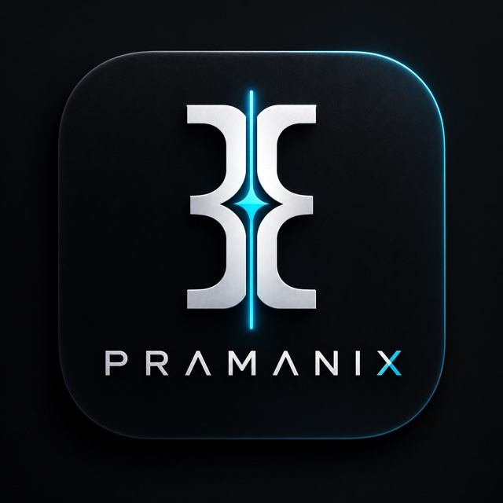

# Reading Room

A calm, private shelf for short reading: stories, essays, poems, letters, comics, and interactive adventures.

Browse a catalogue of public-domain classics and original works. Your reading progress, bookmarks, highlights, and notes stay in your browser by default. Sign in only when you want to sync your shelf across devices.

## Features

- Search and filter by genre, form, author, period, language, and reading time
- Switch between illustrated card browsing and a compact story list, with a calm “show more” control
- Illustrated editorial story cards with distinct locally rendered cover art and optional persistent cover-image URLs
- Mood-led genre browsing, including mystery, myths, romance, quiet reading, and adventure
- A Daily Escape feature with a stable daily story, cover art, teaser, and direct reading action
- Story detail cover art, language metadata, passage navigation, and a distraction-free reader mode
- Curated collections and a “Surprise me” option
- Reader themes and controls for type size, line spacing, and reading width
- First-party story translation into English, Hindi, and Marathi when Google Cloud Translation is configured
- Four optional, locally bundled ambience recordings with playback controls and creator/license credits
- Local bookmarks, highlights, margin notes, daily goals, and backup/restore
- Optional account sync
- Writer applications for regional and multilingual storytellers, with a private administrator review area
- Installable PWA with share cards and an install guide

## Run locally

**Requirements:** Node.js 22 or later and npm.

```sh
git clone https://github.com/manthankro/reading-room.git
cd reading-room
npm ci
npm run dev
```

Open the address printed by Vite. The development server uses port 8080.

Useful commands:

| Command | Purpose |
| --- | --- |
| `npm run dev` | Start the development server |
| `npm run lint` | Run ESLint |
| `npm run typecheck` | Check TypeScript |
| `npm test` | Run the test suite |
| `npm run build` | Build the production app and apply configured migrations |
| `npm run preview` | Preview a production build |

## Visual reading experience

Reading Room creates deterministic, story-specific SVG cover illustrations locally from each work’s slug and thematic metadata. The same cover component is reused in the daily feature, catalogue cards, and reader detail page. Works can optionally define a `coverImage` URL in their catalogue data to use a persistent hosted cover instead. The catalogue includes original works in English, Hindi, Marathi, Gujarati, Bengali, Tamil, Telugu, Kannada, and Malayalam; additional languages can be added through the same metadata field. Covers remain outside the reading text so focus mode stays uncluttered. The catalogue is currently code-managed; a database-backed cover upload/admin interface is not part of this release.

## How it works

Reading Room is a full-stack React application built with TanStack Start and Vite. TanStack Router handles file-based routes; Nitro packages the server for Vercel.

The catalogue is stored in TypeScript modules under `src/lib/`. Reading data is local-first and uses the browser by default. When sign-in and a database are configured, Better Auth protects account features and Postgres stores the signed-in reader’s synced shelf. Builds without a database skip the deploy-time migration step; local preview can use PGLite. The catalogue includes original Reading Room stories in eight Indian languages alongside its English collection.

## Configuration

Most readers can use the app without environment variables. To enable deployed sign-in and cross-device sync, configure the Better Auth provider credentials and a Postgres `DATABASE_URL` in the deployment environment. Keep secrets server-side and out of the repository.

Writer applications require these server-side Vercel environment variables:

- `DATABASE_URL` — persistent Postgres storage for submitted applications; the Vercel Neon integration's `POSTGRES_URL` is also accepted automatically
- `WRITER_APPLICATION_EMAIL` — verified team inbox for application notifications
- `WRITER_APPLICATION_FROM` — optional display/sender address; Gmail defaults to `Reading Room <GMAIL_SMTP_USER>`
- `RESEND_API_KEY` — optional Resend API key, stored only as a server secret (used when Gmail SMTP is not configured)
- `GMAIL_SMTP_USER` — Gmail account that owns the App Password
- `GMAIL_APP_PASSWORD` — Gmail App Password, stored only as a server secret; Gmail SMTP is preferred when configured
- `WRITER_ADMIN_EMAILS` — comma-separated email addresses allowed to access `/admin/writers`; each must match a verified signed-in account
- `APP_BASE_URL` — public site URL used in notification links

Configure these in Vercel for Preview and Production. Never commit actual values. The application form saves entries to Postgres first; if email is unavailable, the entry remains saved and an administrator can retry the notification from the private review area. To make a user an administrator, add their email to `WRITER_ADMIN_EMAILS` and have them sign in with that verified email.

Story translation requires `GOOGLE_CLOUD_TRANSLATE_API_KEY` as a server-only Vercel environment variable, with the Cloud Translation API enabled for its Google Cloud project. Restrict the key to that API and do not use a `VITE_` prefix. Translation targets are English, Hindi, and Marathi; source text stays unchanged and translated output is cached in server memory for up to 24 hours. Translation requests are limited to eight per client address per ten minutes in each server instance; use an edge rate limit as traffic scales because Vercel can run multiple instances. Google Cloud Translation is a billed service; check current Google Cloud pricing and quotas before enabling it. Translation is limited to Reading Room original works to respect third-party content rights.

The ambient recordings are shipped locally under `public/ambient/`. Source and license details are in [AUDIO-LICENSES.md](AUDIO-LICENSES.md).

The app can also receive `VITE_*` settings at build time. Only use that prefix for values that are safe to expose to the browser.

## Quality checks and CI

GitHub Actions runs on pushes and pull requests targeting `main`. It installs from the lockfile and runs:

1. `npm run lint`
2. `npm run typecheck`
3. `npm test`
4. `npm run build`

Run the same checks locally before opening a pull request.

## Project structure

```text
.github/workflows/  CI workflow
migrations/         SQL migrations
public/             Static assets, PWA art, and share-card images
scripts/            Build helpers, migrations, and unit tests
server/             Nitro middleware
src/components/     Library and reader interface
src/lib/            Catalogue, reading state, auth, and database helpers
src/routes/         TanStack file-based routes
```

## Catalogue and content

The catalogue combines public-domain works with original Reading Room pieces. Each work includes its source and provenance information where applicable. The code is licensed under MIT; individual texts, illustrations, and other media may have separate rights and reuse terms. Check the attribution and provenance supplied with an item before reusing its content.

## Contributing

1. Create a branch for your change.
2. Make the change and add or update tests when behavior changes.
3. Run lint, typecheck, tests, and the production build.
4. Open a pull request with a short description and any relevant screenshots.

Please avoid committing secrets, local environment files, or generated build output.

## License

The application code is released under the [MIT License](LICENSE), copyright Manthan Lonkar. Catalogue texts and media may have separate terms as described above.
